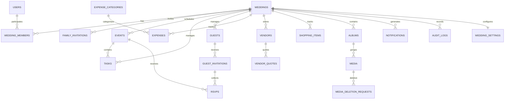

# Make My Marriage
## Database Design Document – MongoDB

**Document Version:** 1.0  
**Date:** 8 November 2026  
**Database:** MongoDB Atlas  
**Application:** Make My Marriage  
**Backend:** Python + FastAPI  
**Architecture:** Modular Monolith  
**Status:** Initial Database Design

---

# 1. Introduction

## 1.1 Purpose

This document defines the MongoDB database architecture for Make My Marriage.

It describes:

- Database collections.
- Collection responsibilities.
- Field names and data types.
- Relationships between collections.
- MongoDB indexes.
- Sample documents.
- Data access and security rules.
- Data lifecycle and deletion policies.

This document will act as the database implementation reference for the backend development team.

## 1.2 Database Selection

We will use MongoDB Atlas as our primary database.

MongoDB is suitable for this application because:

- Wedding information has flexible structures.
- Different weddings can have different events and requirements.
- Users can participate in multiple weddings.
- Guest, task, expense and gallery records can grow independently.
- Embedded documents can be used for small, closely related data.
- Separate collections can be used for independently growing records.

## 1.3 Database Name

Production database:

`make_my_marriage`

Development database:

`make_my_marriage_dev`

Use separate database configurations for development and production.

---

# 2. Database Design Principles

The following principles will guide our database design.

1. Every user must have one unique user record.
2. One user can create multiple weddings.
3. One user can participate in multiple weddings.
4. Each wedding has two equal owners: bride and groom.
5. Each wedding has its own family members and permissions.
6. Users can have different roles in different weddings.
7. Every wedding-related record must contain `wedding_id`.
8. Sensitive information must be protected by backend authorization.
9. Photos and videos must be stored in Amazon S3, not MongoDB.
10. MongoDB stores media metadata and S3 storage references.
11. Permanent deletion and archiving must be separate operations.
12. Important operations must be recorded in audit history.

## 2.1 MongoDB Data Types

| Type | Usage | Example |
|---|---|---|
| ObjectId | Document identifier | `_id` |
| String | Names, email, status | `"planning"` |
| Boolean | True/false values | `true` |
| Date | Dates and timestamps | `ISODate(...)` |
| Decimal128 | Financial amounts | `Decimal128("25000.00")` |
| Array | Multiple values | `["email", "sms"]` |
| Object | Nested information | Address object |

**Important:** Use MongoDB `ObjectId` for document references. The examples below use readable string IDs for explanation; actual implementation should use BSON ObjectIds consistently.

Store timestamps in UTC. Store wedding event dates and times with the wedding's relevant timezone, such as `Asia/Kolkata`.

---

# 3. Database Collection Overview

We will initially create the following collections.

| No. | Collection | Responsibility |
|---:|---|---|
| 1 | users | User accounts |
| 2 | otp_records | Email OTP verification |
| 3 | weddings | Wedding information |
| 4 | wedding_members | Wedding membership and permissions |
| 5 | family_invitations | Family member invitations |
| 6 | events | Wedding events |
| 7 | tasks | Wedding tasks |
| 8 | guests | Guest information |
| 9 | guest_invitations | Guest invitation links |
| 10 | rsvps | Guest responses |
| 11 | expenses | Private expense records |
| 12 | expense_categories | Expense categories |
| 13 | vendors | Vendor information |
| 14 | vendor_quotes | Vendor quotations |
| 15 | shopping_items | Shopping checklist |
| 16 | albums | Photo and video albums |
| 17 | media | Media metadata |
| 18 | media_deletion_requests | Joint deletion approval |
| 19 | notifications | Email, WhatsApp and SMS delivery |
| 20 | audit_logs | Activity history |
| 21 | wedding_settings | Wedding preferences and visibility |

This is the initial logical collection design. We can add collections when new requirements justify them.

---

# 4. Collection Design

## 4.1 Users Collection

**Collection:** `users`

Purpose: Store the global user account and profile information.

One user can participate in multiple weddings.

### Schema

| Field | Type | Required | Description |
|---|---|---|---|
| `_id` | ObjectId | Yes | Unique user ID |
| `full_name` | String | Yes | User name |
| `email` | String | Yes | Verified email |
| `phone` | String | No | Phone number |
| `profile_image` | String | No | Profile image reference |
| `auth_providers` | Array | Yes | Linked login providers |
| `email_verified` | Boolean | Yes | Email verification |
| `phone_verified` | Boolean | Yes | Phone verification |
| `account_status` | String | Yes | active/disabled/deleted |
| `created_at` | Date | Yes | Account creation |
| `updated_at` | Date | Yes | Last update |

### Sample Document

```json
{
  "_id": "ObjectId",
  "full_name": "Rahul Kumar",
  "email": "rahul@example.com",
  "phone": "+919876543210",
  "profile_image": null,
  "auth_providers": [
    {
      "provider": "google",
      "provider_user_id": "google_subject_id"
    },
    {
      "provider": "email_otp",
      "verified": true
    }
  ],
  "email_verified": true,
  "phone_verified": false,
  "account_status": "active",
  "created_at": "2026-11-08T10:00:00Z",
  "updated_at": "2026-11-08T10:00:00Z"
}
```

### Indexes

- Unique index on normalized `email`.
- Unique sparse index on normalized `phone`, if phone numbers are used for account identity.
- Index on `account_status`.

Email normalization should happen before saving and querying.

---

## 4.2 OTP Records Collection

**Collection:** `otp_records`

Purpose: Manage email OTP verification.

Confirmed requirements:

- Six-digit OTP.
- Five-minute validity.
- OTP invalidated after successful verification.

### Schema

| Field | Type | Description |
|---|---|---|
| `_id` | ObjectId | OTP record ID |
| `email` | String | Target email |
| `otp_hash` | String | Hashed OTP |
| `purpose` | String | login/registration/account_link |
| `attempt_count` | Number | Incorrect attempts |
| `expires_at` | Date | Expiry time |
| `consumed_at` | Date | Successful verification time |
| `created_at` | Date | Creation time |

### Sample Document

```json
{
  "_id": "ObjectId",
  "email": "rahul@example.com",
  "otp_hash": "secure_hashed_value",
  "purpose": "login",
  "attempt_count": 0,
  "expires_at": "2026-11-08T10:05:00Z",
  "consumed_at": null,
  "created_at": "2026-11-08T10:00:00Z"
}
```

### Indexes

- Index on `email + purpose + created_at`.
- TTL index on `expires_at`.

TTL cleanup is asynchronous. The backend must check expiry explicitly; it must never rely on MongoDB deleting an expired OTP immediately.

---

## 4.3 Weddings Collection

**Collection:** `weddings`

Purpose: Store the main wedding information.

Each wedding has exactly two owners:

- Bride.
- Groom.

Both owners have equal authority.

### Schema

| Field | Type | Description |
|---|---|---|
| `_id` | ObjectId | Wedding ID |
| `title` | String | Wedding title |
| `slug` | String | Public website URL identifier |
| `bride` | Object | Bride details |
| `groom` | Object | Groom details |
| `owner_user_ids` | Array | Two owner user IDs |
| `wedding_date` | Date | Wedding date |
| `timezone` | String | Wedding timezone |
| `venue` | Object | Wedding venue |
| `status` | String | planning/ongoing/completed/archived |
| `created_by` | ObjectId | Creator user ID |
| `created_at` | Date | Creation date |
| `updated_at` | Date | Update date |
| `archived_at` | Date/null | Archive date |

### Sample Document

```json
{
  "_id": "ObjectId",
  "title": "Rahul and Priya Wedding",
  "slug": "rahul-and-priya",
  "bride": {
    "user_id": "ObjectId",
    "name": "Priya"
  },
  "groom": {
    "user_id": "ObjectId",
    "name": "Rahul"
  },
  "owner_user_ids": [
    "ObjectId",
    "ObjectId"
  ],
  "wedding_date": "2027-02-15T00:00:00Z",
  "timezone": "Asia/Kolkata",
  "venue": {
    "name": "Convention Hall",
    "address": "Nellore, Andhra Pradesh"
  },
  "status": "planning",
  "created_by": "ObjectId",
  "created_at": "2026-11-08T10:00:00Z",
  "updated_at": "2026-11-08T10:00:00Z",
  "archived_at": null
}
```

### Indexes

- Unique index on `slug`.
- Index on `owner_user_ids`.
- Index on `status`.
- Index on `wedding_date`.

**Design rule:** The backend must validate that exactly two distinct, eligible users are assigned as owners. Both must have equal owner permissions.

---

## 4.4 Wedding Members Collection

**Collection:** `wedding_members`

Purpose: Connect users with individual weddings.

This collection is very important because a user can have different roles in different weddings.

### Schema

| Field | Type | Description |
|---|---|---|
| `_id` | ObjectId | Membership ID |
| `wedding_id` | ObjectId | Wedding reference |
| `user_id` | ObjectId | User reference |
| `role` | String | owner/family_member/manager |
| `relationship` | String | sister/brother/friend/etc. |
| `permissions` | Object | Assigned permissions |
| `invited_by` | ObjectId | Inviting owner |
| `status` | String | invited/active/suspended/removed |
| `joined_at` | Date | Joining date |
| `created_at` | Date | Creation date |

### Sample Document

```json
{
  "_id": "ObjectId",
  "wedding_id": "ObjectId",
  "user_id": "ObjectId",
  "role": "family_member",
  "relationship": "sister",
  "permissions": {
    "manage_events": true,
    "manage_tasks": true,
    "manage_guests": true,
    "send_guest_invitations": false,
    "view_expenses": false,
    "manage_vendors": false,
    "manage_gallery": true,
    "upload_media": true,
    "delete_media": false
  },
  "invited_by": "ObjectId",
  "status": "active",
  "joined_at": "2026-11-08T10:00:00Z",
  "created_at": "2026-11-08T10:00:00Z"
}
```

### Indexes

- Unique compound index on `wedding_id + user_id`.
- Index on `user_id + status`.
- Index on `wedding_id + role`.

### Important Rules

- Owners have equal permissions.
- Managers only receive explicitly assigned permissions.
- Relationship does not automatically determine permissions.
- A family member cannot invite another family member.
- Membership removal must revoke access immediately.

---

## 4.5 Family Invitations Collection

**Collection:** `family_invitations`

Purpose: Manage invitations to join a wedding workspace.

### Schema

| Field | Type | Description |
|---|---|---|
| `_id` | ObjectId | Invitation ID |
| `wedding_id` | ObjectId | Wedding reference |
| `email` | String | Invitee email |
| `phone` | String | Invitee phone |
| `token_hash` | String | Secure invitation token hash |
| `role` | String | Requested role |
| `permissions` | Object | Proposed permissions |
| `invited_by` | ObjectId | Bride or groom |
| `status` | String | pending/accepted/expired/revoked |
| `expires_at` | Date | Invitation expiry |
| `accepted_at` | Date | Acceptance time |
| `created_at` | Date | Creation date |

### Indexes

- Index on `wedding_id + status`.
- Index on `email + status`.
- Unique index on `token_hash`.

Keep invitation records for audit and lifecycle tracking. Expiry should be checked by the application.

---

## 4.6 Events Collection

**Collection:** `events`

Purpose: Store wedding event information.

Examples:

- Haldi.
- Mehendi.
- Sangeet.
- Wedding.
- Reception.
- Custom events.

### Schema

| Field | Type | Description |
|---|---|---|
| `_id` | ObjectId | Event ID |
| `wedding_id` | ObjectId | Wedding reference |
| `title` | String | Event name |
| `description` | String | Event details |
| `event_type` | String | Event category |
| `start_date` | Date | Starting date/time |
| `end_date` | Date | Ending date/time |
| `venue` | Object | Venue information |
| `visibility` | String | private/public |
| `created_by` | ObjectId | Creator |
| `status` | String | active/cancelled |
| `created_at` | Date | Creation date |

### Sample Document

```json
{
  "_id": "ObjectId",
  "wedding_id": "ObjectId",
  "title": "Haldi Ceremony",
  "description": "Family Haldi celebration",
  "event_type": "haldi",
  "start_date": "2027-02-13T04:00:00Z",
  "end_date": "2027-02-13T07:00:00Z",
  "venue": {
    "name": "Wedding Home",
    "address": "Nellore"
  },
  "visibility": "public",
  "created_by": "ObjectId",
  "status": "active",
  "created_at": "2026-11-08T10:00:00Z"
}
```

### Indexes

- `wedding_id + start_date`.
- `wedding_id + status`.
- `wedding_id + event_type`.

---

## 4.7 Tasks Collection

**Collection:** `tasks`

Purpose: Manage wedding-related tasks.

### Schema

| Field | Type | Description |
|---|---|---|
| `_id` | ObjectId | Task ID |
| `wedding_id` | ObjectId | Wedding reference |
| `event_id` | ObjectId/null | Related event |
| `title` | String | Task name |
| `description` | String | Details |
| `assigned_to` | ObjectId/null | Assigned user |
| `priority` | String | low/medium/high |
| `status` | String | todo/in_progress/completed |
| `due_date` | Date | Deadline |
| `created_by` | ObjectId | Creator |
| `created_at` | Date | Creation date |
| `updated_at` | Date | Update date |

### Indexes

- `wedding_id + status`.
- `wedding_id + assigned_to`.
- `wedding_id + due_date`.
- `event_id`.

---

## 4.8 Guests Collection

**Collection:** `guests`

Purpose: Store guest information for each wedding.

Guests do not need platform accounts.

### Schema

| Field | Type | Description |
|---|---|---|
| `_id` | ObjectId | Guest ID |
| `wedding_id` | ObjectId | Wedding reference |
| `full_name` | String | Guest name |
| `email` | String | Email |
| `phone` | String | Phone |
| `household_id` | ObjectId/null | Household grouping |
| `guest_group` | String | Family/friend/colleague |
| `added_by` | ObjectId | User who added guest |
| `status` | String | active/archived |
| `created_at` | Date | Creation date |

### Indexes

- `wedding_id + full_name`.
- `wedding_id + phone`.
- `wedding_id + email`.
- `wedding_id + household_id`.

The application should support duplicate detection without assuming two people with the same name or phone are necessarily the same guest.

---

## 4.9 Guest Invitations Collection

**Collection:** `guest_invitations`

Purpose: Generate secure links for guest invitations and RSVP.

### Schema

| Field | Type | Description |
|---|---|---|
| `_id` | ObjectId | Invitation ID |
| `wedding_id` | ObjectId | Wedding reference |
| `guest_id` | ObjectId | Guest reference |
| `token_hash` | String | Secure token hash |
| `event_ids` | Array | Invited events |
| `channels` | Array | Email/WhatsApp/SMS |
| `status` | String | pending/sent/revoked/expired |
| `expires_at` | Date | Expiry |
| `created_by` | ObjectId | Sender |
| `created_at` | Date | Creation date |

### Indexes

- Unique index on `token_hash`.
- `wedding_id + guest_id`.
- `wedding_id + status`.

Guest links must only access the intended guest's invitation and RSVP functionality.

---

## 4.10 RSVPs Collection

**Collection:** `rsvps`

Purpose: Store guest responses.

### Schema

| Field | Type | Description |
|---|---|---|
| `_id` | ObjectId | RSVP ID |
| `wedding_id` | ObjectId | Wedding reference |
| `guest_id` | ObjectId | Guest reference |
| `guest_invitation_id` | ObjectId | Invitation reference |
| `event_id` | ObjectId | Event reference |
| `response` | String | attending/not_attending/maybe |
| `guest_count` | Number | Number attending |
| `dietary_notes` | String | Optional notes |
| `submitted_at` | Date | Submission time |
| `updated_at` | Date | Update time |

### Indexes

- Unique compound index on `guest_invitation_id + event_id`.
- `wedding_id + event_id + response`.
- `guest_id`.

This supports one response per invitation per event, with updates to the existing response.

---

## 4.11 Expenses Collection

**Collection:** `expenses`

Purpose: Track wedding expenses.

**Privacy requirement:** Only bride and groom can view complete expense information.

### Schema

| Field | Type | Description |
|---|---|---|
| `_id` | ObjectId | Expense ID |
| `wedding_id` | ObjectId | Wedding reference |
| `category_id` | ObjectId | Expense category |
| `title` | String | Expense name |
| `amount` | Decimal128 | Expense amount |
| `currency` | String | INR |
| `paid_to` | String | Recipient/vendor |
| `payment_status` | String | pending/partial/paid |
| `payment_date` | Date | Payment date |
| `notes` | String | Notes |
| `created_by` | ObjectId | Creator |
| `created_at` | Date | Creation date |

### Sample Document

```json
{
  "_id": "ObjectId",
  "wedding_id": "ObjectId",
  "category_id": "ObjectId",
  "title": "Wedding Photography",
  "amount": {
    "$numberDecimal": "25000.00"
  },
  "currency": "INR",
  "paid_to": "ABC Photography",
  "payment_status": "partial",
  "payment_date": "2026-11-08T10:00:00Z",
  "notes": "Advance payment",
  "created_by": "ObjectId",
  "created_at": "2026-11-08T10:00:00Z"
}
```

### Indexes

- `wedding_id + category_id`.
- `wedding_id + created_at`.
- `wedding_id + payment_status`.

**Security rule:** Every expense query must verify that the authenticated user is one of the two wedding owners. Do not rely on frontend visibility restrictions.

---

## 4.12 Expense Categories Collection

**Collection:** `expense_categories`

Purpose: Store expense categories.

Examples:

- Venue.
- Catering.
- Photography.
- Decoration.
- Jewellery.
- Clothing.
- Travel.
- Miscellaneous.

### Schema

| Field | Type | Description |
|---|---|---|
| `_id` | ObjectId | Category ID |
| `wedding_id` | ObjectId | Wedding reference |
| `name` | String | Category name |
| `created_by` | ObjectId | Creator |
| `created_at` | Date | Creation date |

### Indexes

- Unique compound index on `wedding_id + name`.

---

## 4.13 Vendors Collection

**Collection:** `vendors`

Purpose: Store vendor information.

### Schema

| Field | Type | Description |
|---|---|---|
| `_id` | ObjectId | Vendor ID |
| `wedding_id` | ObjectId | Wedding reference |
| `name` | String | Vendor name |
| `category` | String | Vendor category |
| `phone` | String | Contact number |
| `email` | String | Email |
| `address` | Object | Address |
| `notes` | String | Additional details |
| `created_by` | ObjectId | Creator |
| `created_at` | Date | Creation date |

### Indexes

- `wedding_id + category`.
- `wedding_id + name`.

---

## 4.14 Vendor Quotes Collection

**Collection:** `vendor_quotes`

Purpose: Store vendor quotations and payment details.

### Schema

| Field | Type | Description |
|---|---|---|
| `_id` | ObjectId | Quote ID |
| `wedding_id` | ObjectId | Wedding reference |
| `vendor_id` | ObjectId | Vendor reference |
| `event_id` | ObjectId/null | Related event |
| `quoted_amount` | Decimal128 | Quoted amount |
| `final_amount` | Decimal128/null | Final amount |
| `advance_paid` | Decimal128 | Advance payment |
| `payment_status` | String | pending/partial/paid |
| `notes` | String | Notes |
| `created_at` | Date | Creation date |

### Indexes

- `wedding_id + vendor_id`.
- `wedding_id + event_id`.

---

## 4.15 Shopping Items Collection

**Collection:** `shopping_items`

Purpose: Maintain a wedding shopping checklist.

### Schema

| Field | Type | Description |
|---|---|---|
| `_id` | ObjectId | Item ID |
| `wedding_id` | ObjectId | Wedding reference |
| `title` | String | Item name |
| `category` | String | Shopping category |
| `estimated_price` | Decimal128 | Estimated price |
| `actual_price` | Decimal128/null | Actual price |
| `assigned_to` | ObjectId/null | Responsible member |
| `status` | String | pending/purchased |
| `notes` | String | Notes |
| `created_by` | ObjectId | Creator |
| `created_at` | Date | Creation date |

### Indexes

- `wedding_id + status`.
- `wedding_id + assigned_to`.

---

## 4.16 Albums Collection

**Collection:** `albums`

Purpose: Group wedding media into albums.

Examples:

- Engagement.
- Haldi.
- Mehendi.
- Wedding.
- Reception.

### Schema

| Field | Type | Description |
|---|---|---|
| `_id` | ObjectId | Album ID |
| `wedding_id` | ObjectId | Wedding reference |
| `name` | String | Album name |
| `description` | String | Description |
| `visibility` | String | private/public |
| `created_by` | ObjectId | Creator |
| `created_at` | Date | Creation date |

### Indexes

- `wedding_id + name`.
- `wedding_id + visibility`.

---

## 4.17 Media Collection

**Collection:** `media`

Purpose: Store metadata for photos, videos and documents.

Actual files are stored in Amazon S3.

### Schema

| Field | Type | Description |
|---|---|---|
| `_id` | ObjectId | Media ID |
| `wedding_id` | ObjectId | Wedding reference |
| `album_id` | ObjectId | Album reference |
| `uploaded_by` | ObjectId | Uploader |
| `file_name` | String | Original file name |
| `storage_key` | String | S3 object key |
| `media_type` | String | image/video/document |
| `mime_type` | String | File content type |
| `file_size` | Number | File size in bytes |
| `visibility` | String | private/public |
| `status` | String | uploading/active/archived/deleted |
| `created_at` | Date | Upload date |

### Indexes

- `wedding_id + album_id`.
- `wedding_id + status`.
- `wedding_id + uploaded_by`.

Never store public S3 credentials or permanent public links in this collection.

---

## 4.18 Media Deletion Requests Collection

**Collection:** `media_deletion_requests`

Purpose: Support joint approval from bride and groom before permanent photo deletion.

### Schema

| Field | Type | Description |
|---|---|---|
| `_id` | ObjectId | Request ID |
| `wedding_id` | ObjectId | Wedding reference |
| `media_id` | ObjectId | Media reference |
| `requested_by` | ObjectId | Requesting owner |
| `approvals` | Array | Owner approvals |
| `status` | String | pending/approved/rejected/completed |
| `requested_at` | Date | Request time |
| `completed_at` | Date/null | Deletion time |

### Sample Document

```json
{
  "_id": "ObjectId",
  "wedding_id": "ObjectId",
  "media_id": "ObjectId",
  "requested_by": "ObjectId",
  "approvals": [
    {
      "owner_id": "ObjectId",
      "decision": "approved",
      "approved_at": "2026-11-08T10:00:00Z"
    },
    {
      "owner_id": "ObjectId",
      "decision": "pending",
      "approved_at": null
    }
  ],
  "status": "pending",
  "requested_at": "2026-11-08T10:00:00Z",
  "completed_at": null
}
```

### Important Rules

- Both distinct owners must approve.
- The requesting owner cannot approve on behalf of the other owner.
- Only after both approvals should permanent deletion begin.
- S3 deletion and database status changes must be handled safely and retried if necessary.
- Preserve deletion audit history.

---

## 4.19 Notifications Collection

**Collection:** `notifications`

Purpose: Track invitation and notification delivery across all channels.

### Schema

| Field | Type | Description |
|---|---|---|
| `_id` | ObjectId | Notification ID |
| `wedding_id` | ObjectId | Wedding reference |
| `recipient` | Object | Recipient details |
| `notification_type` | String | family_invitation/guest_invitation |
| `reference_id` | ObjectId | Related invitation |
| `channel` | String | email/whatsapp/sms |
| `status` | String | pending/sent/delivered/failed |
| `provider_message_id` | String | Provider reference |
| `attempt_count` | Number | Delivery attempts |
| `last_error` | String/null | Error information |
| `created_at` | Date | Creation date |
| `updated_at` | Date | Update date |

### Indexes

- `wedding_id + status`.
- `reference_id + channel`.
- `status + created_at`.

Create one delivery record per channel. A WhatsApp failure must not mark a successful email delivery as failed.

---

## 4.20 Audit Logs Collection

**Collection:** `audit_logs`

Purpose: Record important activities for accountability and security.

Examples:

- Wedding created.
- Family member invited.
- Member removed.
- Permission changed.
- Guest invitation sent.
- Expense created.
- Photo deletion requested.
- Photo deletion approved.
- Wedding archived.

### Schema

| Field | Type | Description |
|---|---|---|
| `_id` | ObjectId | Log ID |
| `wedding_id` | ObjectId | Wedding reference |
| `actor_user_id` | ObjectId | User performing action |
| `action` | String | Action name |
| `entity_type` | String | Entity affected |
| `entity_id` | ObjectId | Record affected |
| `metadata` | Object | Safe contextual details |
| `created_at` | Date | Action time |

### Indexes

- `wedding_id + created_at`.
- `actor_user_id + created_at`.
- `entity_type + entity_id`.

Audit logs should be append-only for normal application users. Never include OTP values, raw invitation tokens or unnecessary sensitive personal data.

---

## 4.21 Wedding Settings Collection

**Collection:** `wedding_settings`

Purpose: Store wedding-specific configuration and public website preferences.

### Schema

| Field | Type | Description |
|---|---|---|
| `_id` | ObjectId | Settings ID |
| `wedding_id` | ObjectId | Wedding reference |
| `public_website_enabled` | Boolean | Public page enabled |
| `search_engine_indexing` | Boolean | Search engine visibility |
| `public_fields` | Array | Approved public fields |
| `public_gallery_album_ids` | Array | Public albums |
| `default_timezone` | String | Wedding timezone |
| `updated_by` | ObjectId | Last updater |
| `updated_at` | Date | Last update |

### Indexes

- Unique index on `wedding_id`.

The public API must use this collection as an allowlist, not return complete wedding records.

---

# 5. Collection Relationship Diagram



These are logical relationships. MongoDB does not automatically enforce foreign keys, so the backend must validate referenced documents and their wedding ownership.

---

# 6. Important Database Index Strategy

Indexes improve query performance, but unnecessary indexes increase storage and write costs.

The initial index plan is:

| Collection | Index |
|---|---|
| users | Unique normalized email |
| otp_records | Email + purpose; TTL expiry |
| weddings | Unique slug; owner_user_ids |
| wedding_members | Unique wedding_id + user_id |
| family_invitations | wedding_id + status; unique token_hash |
| events | wedding_id + start_date |
| tasks | wedding_id + status |
| guests | wedding_id + phone |
| guest_invitations | Unique token_hash |
| rsvps | Unique invitation_id + event_id |
| expenses | wedding_id + created_at |
| expense_categories | Unique wedding_id + name |
| vendors | wedding_id + category |
| vendor_quotes | wedding_id + vendor_id |
| shopping_items | wedding_id + status |
| albums | wedding_id + visibility |
| media | wedding_id + album_id |
| media_deletion_requests | wedding_id + status |
| notifications | status + created_at |
| audit_logs | wedding_id + created_at |
| wedding_settings | Unique wedding_id |

Before production, check actual query patterns with MongoDB explain plans and adjust indexes accordingly.

---

# 7. Important Database Security Rules

## 7.1 Wedding Isolation

Every wedding-related query must be scoped to the correct wedding.

Example:

```python
task = await db.tasks.find_one({
    "_id": task_id,
    "wedding_id": wedding_id
})
```

Never fetch a private record using only its ID and assume the caller is authorised.

## 7.2 Expense Privacy

Only the bride and groom can read complete expense records.

## 7.3 Guest Privacy

Guest invitation tokens must only expose the intended guest's invitation and RSVP functions.

## 7.4 Media Privacy

Private media must never be publicly accessible through permanent S3 URLs.

## 7.5 Owner Permissions

Bride and groom must have equal permissions. A regular family member or manager cannot assign themselves owner privileges.

## 7.6 Invitation Security

Store token hashes rather than raw invitation tokens. Validate expiry, status and revocation on every use.

---

# 8. Data Lifecycle and Deletion

| Data | Lifecycle |
|---|---|
| User account | Retained according to account and legal deletion policy |
| OTP | Expire and remove automatically |
| Family invitation | Pending, accepted, revoked or expired |
| Guest invitation | Pending, accepted, revoked or expired |
| Wedding | Planning, ongoing, completed, archived |
| Tasks | Active or completed |
| Media | Active, archived or deleted |
| Expenses | Retained according to financial and privacy policy |
| Audit logs | Retained according to defined retention policy |

Archiving a wedding must not automatically delete its database records.

Permanent deletion should be a separate, controlled workflow.

---

# 9. Recommended MongoDB Implementation Order

We should not create all 21 collections at once and immediately start building every feature.

Implement them in stages.

## Phase 1 – Core Foundation

1. users
2. otp_records
3. weddings
4. wedding_members
5. family_invitations

Goal: Users can register, log in, create weddings and invite family members.

## Phase 2 – Wedding Planning

6. events
7. tasks
8. shopping_items
9. vendors
10. vendor_quotes

Goal: Users can manage wedding planning.

## Phase 3 – Guest Management

11. guests
12. guest_invitations
13. rsvps
14. notifications

Goal: Users can invite guests and collect responses.

## Phase 4 – Finance and Media

15. expense_categories
16. expenses
17. albums
18. media
19. media_deletion_requests

Goal: Manage private wedding expenses and shared media.

## Phase 5 – Platform Administration

20. audit_logs
21. wedding_settings

Goal: Add accountability, public website settings and operational controls.

---

# 10. Final Database Design Decisions

| Requirement | Database decision |
|---|---|
| Multiple weddings per user | Separate users and weddings collections |
| Two equal wedding owners | Two owner IDs in weddings and owner memberships |
| Family collaboration | wedding_members |
| Different roles in different weddings | Wedding-scoped permissions |
| Family invitations | family_invitations |
| Guest invitations | guest_invitations |
| Guests without accounts | Guest records independent of users |
| Event management | events |
| Task management | tasks |
| Private expenses | expenses with owner-only authorization |
| Vendor information | vendors and vendor_quotes |
| Shopping checklist | shopping_items |
| Media storage | S3 with MongoDB metadata |
| Joint photo deletion | media_deletion_requests |
| Three-channel notifications | Separate delivery records per channel |
| Public website | wedding_settings with explicit public allowlist |
| Audit history | audit_logs |
| Archived weddings | Status-based read-only access |

---

# 11. Conclusion

This database design provides the foundation for Make My Marriage.

It supports multiple weddings, shared ownership, family collaboration, guest management, financial privacy, secure media handling and public wedding websites.

The most important design decision is that all wedding-related records are associated with a `wedding_id`. This allows the platform to keep each wedding's information isolated while allowing one user to participate in many weddings.

**Next milestone:** Implement the Phase 1 MongoDB collections and indexes, then connect them to FastAPI.

We will validate the database design through actual use cases before moving to the remaining modules.