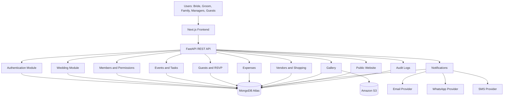
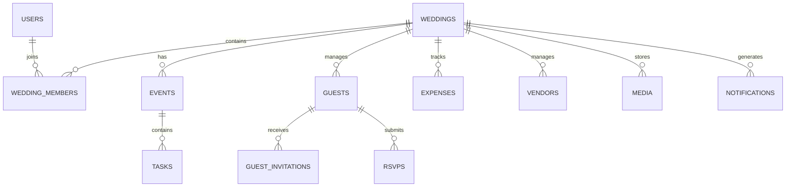
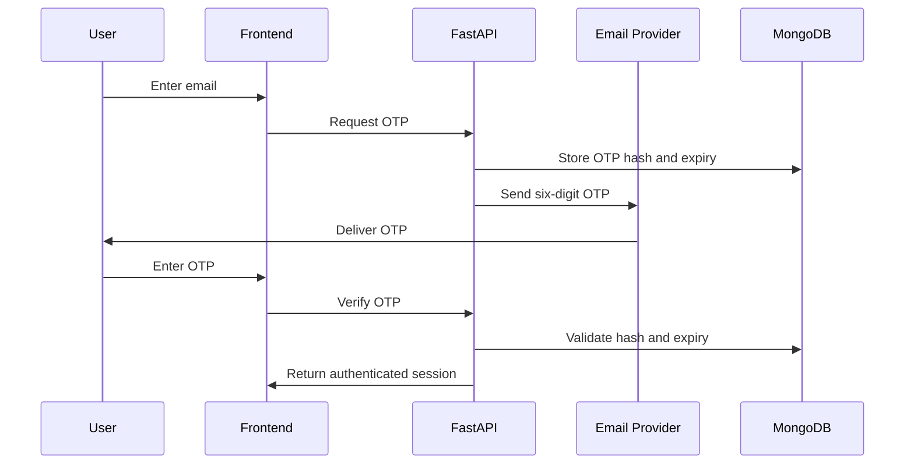
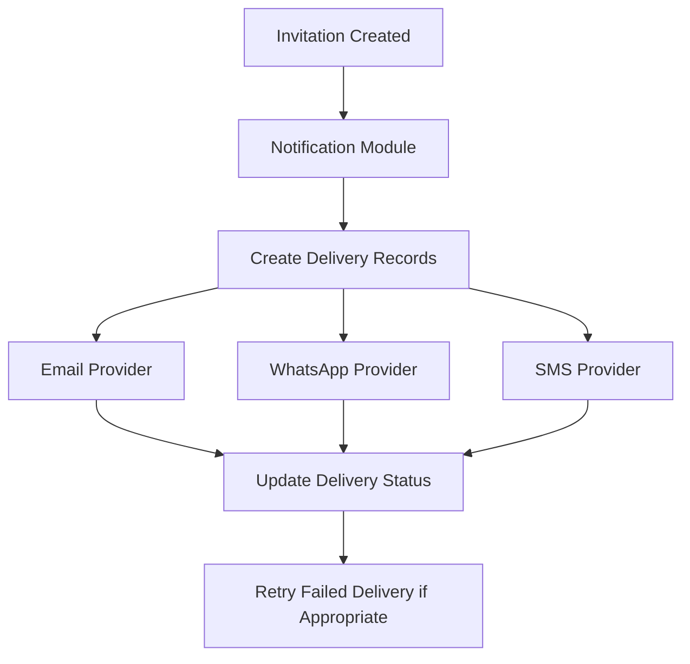
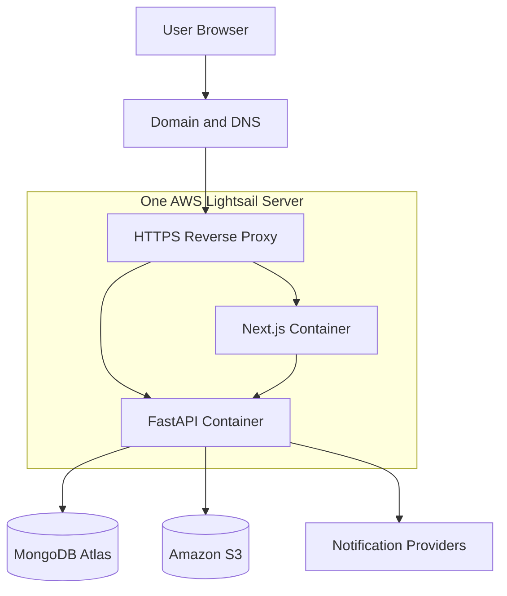

# Make My Marriage
## System Design and Architecture Document (SDD)

**Document Version:** 1.0  
**Date:** 8 November 2026  
**Status:** Initial Architecture – Approved Technology Decisions  
**Architecture Style:** Modular Monolith  
**Product Type:** Multi-wedding management platform

---

# 1. Project Overview

## 1.1 Introduction

Make My Marriage is a web-based wedding management platform that allows couples and their families to plan, manage and coordinate wedding activities through one shared workspace.

The platform supports multiple weddings. A user can create multiple weddings or participate in different weddings with different roles.

Each wedding has two equal owners:

- Bride
- Groom

Both owners can manage the wedding collaboratively and invite family members to participate.

## 1.2 Main Objectives

- Provide one shared workspace for each wedding.
- Allow bride and groom to manage wedding activities equally.
- Allow family members to collaborate based on assigned permissions.
- Manage events, tasks, guests, invitations and RSVPs.
- Track expenses privately for bride and groom.
- Manage vendors, quotations and payments.
- Provide a public wedding website.
- Store photos, videos and documents securely.
- Send invitations through email, WhatsApp and SMS.

## 1.3 Target Users

| User | Description |
|---|---|
| Bride | Wedding owner |
| Groom | Wedding owner |
| Family Member | Invited family participant |
| Manager | Family member with assigned permissions |
| Guest | Person receiving a wedding invitation |

---

# 2. Functional Scope

## 2.1 Initial Release Modules

1. User registration and authentication
2. Wedding creation and management
3. Wedding member management
4. Role and permission management
5. Event management
6. Task management
7. Guest management
8. Digital invitations
9. RSVP management
10. Expense management
11. Vendor management
12. Shopping checklist
13. Photo and video gallery
14. Public wedding website
15. Notifications
16. Audit history

## 2.2 Out of Scope for Initial Release

- Accommodation booking
- Transport booking
- Vendor service bookings
- In-platform family chat
- AI wedding assistant
- Full vendor marketplace
- Microservices architecture

These can be considered for future releases.

---

# 3. Technology Stack

| Layer | Technology | Purpose |
|---|---|---|
| Frontend | Next.js | Web application |
| Backend | Python + FastAPI | REST APIs and business logic |
| Database | MongoDB Atlas | Application data |
| Media Storage | Amazon S3 | Photos, videos and documents |
| Authentication | Google OAuth + Email OTP | User authentication |
| API Style | REST | Frontend/backend communication |
| Deployment | AWS Lightsail | Initial application hosting |
| Containers | Docker + Docker Compose | Application deployment |
| Web Server | Caddy or Nginx | Reverse proxy and HTTPS |
| Version Control | Git + GitHub | Source code management |

### Architecture Decision

We will use a **Modular Monolith**.

This means:

- One backend application.
- One deployment initially.
- Multiple independent business modules.
- Clear module boundaries.
- Shared database infrastructure.
- No unnecessary microservices.

This approach reduces infrastructure complexity and makes the application easier to develop and maintain.

---

# 4. High-Level System Architecture

## 4.1 Architecture Overview



## 4.2 Request Flow

1. User opens the Next.js application.
2. User signs in through Google or email OTP.
3. Next.js communicates with FastAPI using HTTPS.
4. FastAPI authenticates the request.
5. FastAPI checks the user's wedding membership and permissions.
6. The appropriate module executes the business logic.
7. Data is read from or written to MongoDB.
8. The API returns the response to Next.js.

For media uploads, the browser uploads directly to Amazon S3 using a short-lived pre-signed URL issued by FastAPI.

---

# 5. Backend Modular Architecture

Each module will have its own routes, schemas, services and repository/data-access layer.

Suggested project structure:

```text
backend/
│
├── app/
│   ├── main.py
│   │
│   ├── core/
│   │   ├── config.py
│   │   ├── security.py
│   │   ├── database.py
│   │   └── permissions.py
│   │
│   ├── modules/
│   │   ├── auth/
│   │   ├── users/
│   │   ├── weddings/
│   │   ├── members/
│   │   ├── events/
│   │   ├── tasks/
│   │   ├── guests/
│   │   ├── invitations/
│   │   ├── rsvp/
│   │   ├── expenses/
│   │   ├── vendors/
│   │   ├── shopping/
│   │   ├── gallery/
│   │   ├── notifications/
│   │   ├── public_website/
│   │   └── audit/
│   │
│   └── integrations/
│       ├── email/
│       ├── whatsapp/
│       ├── sms/
│       └── storage/
│
├── tests/
├── requirements.txt
└── Dockerfile
```

## 5.1 Module Responsibilities

| Module | Responsibility |
|---|---|
| Auth | Google login, email OTP, sessions |
| Users | User profiles |
| Weddings | Create and update weddings |
| Members | Family invitations and membership |
| Permissions | Access control |
| Events | Wedding event scheduling |
| Tasks | Assign and track tasks |
| Guests | Guest information |
| Invitations | Digital invitation delivery |
| RSVP | Guest responses |
| Expenses | Private expense tracking |
| Vendors | Vendor details and quotations |
| Shopping | Wedding shopping checklist |
| Gallery | Photo, video and document management |
| Notifications | Email, WhatsApp and SMS |
| Public Website | Public wedding pages |
| Audit | Important activity history |

Modules must communicate through defined service interfaces. Avoid directly accessing another module's internal implementation.

---

# 6. Database Architecture – MongoDB

## 6.1 Database Design Principles

- Each wedding has a unique wedding ID.
- Every wedding-related record must include `wedding_id`.
- Users can participate in multiple weddings.
- A user can have different roles in different weddings.
- Bride and groom are equal owners.
- Large or independently growing datasets should use separate collections.
- Sensitive information must be protected through backend authorization.

## 6.2 Proposed Collections

| Collection | Purpose |
|---|---|
| users | User accounts |
| otp_records | Email OTP verification |
| weddings | Wedding information |
| wedding_members | Users and roles in each wedding |
| family_invitations | Family membership invitations |
| events | Wedding events |
| tasks | Assigned tasks |
| guests | Guest information |
| guest_invitations | Guest invitation links |
| rsvps | Guest responses |
| expenses | Wedding expenses |
| expense_categories | Expense categories |
| vendors | Vendor details |
| vendor_quotes | Vendor quotations |
| shopping_items | Shopping checklist |
| media | Media metadata |
| albums | Gallery albums |
| notifications | Delivery and notification records |
| audit_logs | Important activity history |
| wedding_settings | Wedding preferences and visibility settings |

## 6.3 Important Relationships



## 6.4 Example Wedding Document

```json
{
  "_id": "wedding_001",
  "title": "Rahul and Priya Wedding",
  "slug": "rahul-and-priya",
  "bride_owner_id": "user_001",
  "groom_owner_id": "user_002",
  "wedding_date": "2027-02-15",
  "status": "planning",
  "created_at": "2026-11-08T10:00:00Z"
}
```

## 6.5 Example Wedding Member Document

```json
{
  "_id": "member_001",
  "wedding_id": "wedding_001",
  "user_id": "user_003",
  "role": "family_member",
  "relationship": "sister",
  "permissions": {
    "manage_events": true,
    "manage_tasks": true,
    "manage_guests": true,
    "manage_expenses": false,
    "manage_gallery": false
  },
  "invited_by": "user_001",
  "status": "active"
}
```

Relationship is profile metadata. It does not automatically grant permissions.

## 6.6 Example Task Document

```json
{
  "_id": "task_001",
  "wedding_id": "wedding_001",
  "event_id": "event_001",
  "title": "Book wedding photographer",
  "assigned_to": "user_003",
  "status": "in_progress",
  "due_date": "2027-01-10"
}
```

## 6.7 Important Indexes

Create indexes for common queries:

- `users.email` – unique
- `weddings.slug` – unique
- `wedding_members.wedding_id + user_id` – unique
- `events.wedding_id + event_date`
- `tasks.wedding_id + status`
- `guests.wedding_id`
- `rsvps.guest_invitation_id`
- `expenses.wedding_id + created_at`
- `media.wedding_id + album_id`
- `notifications.wedding_id + status`
- `audit_logs.wedding_id + created_at`

Additional indexes should be validated against real query patterns before production.

---

# 7. Authentication and Authorization

## 7.1 Authentication Methods

Users can log in using:

1. Google Sign-In
2. Email OTP

Both methods must resolve to the same user account when the verified email identity matches. Account linking must be secure.

## 7.2 Email OTP Workflow

Confirmed requirement:

- Six-digit OTP.
- Five-minute expiry.

Workflow:



Security rules:

- Store only an OTP hash.
- Limit verification attempts.
- Apply resend rate limits.
- Invalidate OTP after successful verification.
- Do not reveal whether an email is registered unnecessarily.
- Use secure, HttpOnly and SameSite cookies for browser sessions where appropriate.

## 7.3 Authorization Model

Permissions are scoped to a wedding.

| Capability | Bride | Groom | Family | Manager |
|---|---|---|---|---|
| Manage wedding | Yes | Yes | No | If assigned |
| Invite family | Yes | Yes | No | No |
| Manage events | Yes | Yes | If allowed | If allowed |
| Add guests | Yes | Yes | Yes | If allowed |
| Send guest invitations | Yes | Yes | No by default | If allowed |
| View all expenses | Yes | Yes | No | No |
| Manage gallery | Yes | Yes | If allowed | If allowed |
| Permanent photo deletion | Joint approval | Joint approval | No | No |

Managers receive explicit permissions. The manager title itself does not grant access to sensitive information.

Every protected API request must validate:

1. User identity.
2. Wedding membership.
3. Resource ownership or wedding association.
4. Required permission.
5. Any special approval requirement.

---

# 8. Wedding Management Module

A user can create multiple weddings and participate in multiple weddings.

Each wedding has:

- Wedding title
- Bride details
- Groom details
- Wedding date
- Venue information
- Events
- Members
- Guests
- Tasks
- Expenses
- Vendors
- Gallery
- Public website settings

## 8.1 Wedding Lifecycle

```text
Planning
   |
   v
Ongoing
   |
   v
Completed
   |
   v
Archived
```

Archived weddings become read-only for owners. Family access is removed or restricted according to the archive policy.

Restoration and permanent deletion policies should be explicitly implemented before release.

---

# 9. Family Member Management

## 9.1 Family Invitation Workflow

1. Bride or groom enters the family member's email or phone number.
2. Backend creates a family invitation.
3. Invitation is sent through the configured channels.
4. Family member opens the secure invitation link.
5. User signs in or registers.
6. Backend associates the user with the wedding.
7. Assigned permissions become active.

Only bride and groom can invite family members.

## 9.2 Member Removal

- The owner who invited a member can request removal.
- If that inviting owner becomes unavailable, both owners must approve removal.
- Removal should revoke access without deleting the user's account or historical activity.

---

# 10. Guest Management and RSVP

Guests do not need platform accounts.

## 10.1 Guest Invitation Flow

1. A family member adds guest information.
2. Bride, groom or an authorised manager sends the invitation.
3. The platform creates a secure guest-specific invitation link.
4. The invitation is sent through email, WhatsApp and SMS.
5. Guest opens the link.
6. Guest submits RSVP.
7. RSVP is saved against the guest and relevant event.

## 10.2 Guest Link Security

- Use cryptographically secure random tokens.
- Store token hashes rather than raw tokens.
- Support expiry and revocation.
- Scope the link to the intended guest or household.
- Do not expose the complete guest list.
- Prevent access to private workspace information.

---

# 11. Notification Architecture

## 11.1 Delivery Channels

Confirmed requirement: automatically send invitations through all three channels.

- Email
- WhatsApp
- SMS

## 11.2 Notification Workflow



Each channel has an independent delivery record.

Example statuses:

- Pending
- Processing
- Sent
- Delivered
- Failed
- Retry scheduled

The platform should use a background worker and a persistent job queue for delivery and retry processing. A database-backed job mechanism can be used initially; a dedicated queue can be introduced when traffic justifies it.

Use approved WhatsApp templates where required, and respect consent, opt-out and provider rules.

---

# 12. Expense Management

Expenses are private to bride and groom.

Features:

- Add expense.
- Update expense.
- Delete expense subject to policy.
- Expense categories.
- Payment status.
- Payment date.
- Notes.
- Total wedding expense.
- Category-wise summaries.

Family members and managers must not access complete expense records.

The backend must enforce this restriction. Hiding the expense page in the frontend is not sufficient.

---

# 13. Vendor Management

Initial release focuses on storing vendor information.

Features:

- Vendor name.
- Category.
- Contact number.
- Email.
- Address.
- Quotation details.
- Payment information.
- Related wedding events.
- Notes.

Vendor discovery using Google Maps or Places is postponed until a later release.

There will be no vendor booking marketplace in the initial version.

---

# 14. Shopping Checklist

Features:

- Add shopping item.
- Assign responsible person.
- Set estimated price.
- Track purchase status.
- Add notes.
- Mark item as completed.

Shopping is a checklist module, not an e-commerce platform.

---

# 15. Gallery and Media Management

## 15.1 Storage Design

MongoDB stores media metadata. Amazon S3 stores the actual files.

Example media record:

```json
{
  "_id": "media_001",
  "wedding_id": "wedding_001",
  "album_id": "album_001",
  "uploaded_by": "user_003",
  "file_name": "wedding_photo.jpg",
  "storage_key": "weddings/wedding_001/media/media_001",
  "media_type": "image",
  "visibility": "private",
  "created_at": "2027-02-15T10:00:00Z"
}
```

## 15.2 Upload Workflow

1. User selects a file.
2. Next.js requests an upload URL.
3. FastAPI validates membership and upload permission.
4. FastAPI generates a short-lived S3 pre-signed URL.
5. Browser uploads directly to S3.
6. Backend verifies the upload and saves metadata.
7. Gallery displays the file through an authorised viewing mechanism.

## 15.3 Security

- Restrict file types and sizes.
- Generate unique storage keys.
- Keep private media buckets private.
- Use short-lived signed viewing URLs or an authorised delivery layer.
- Validate file ownership and wedding membership.
- Consider malware scanning for uploaded documents.
- Apply retention and deletion policies.

## 15.4 Photo Deletion

Permanent photo deletion requires approval from both bride and groom.

Archiving and permanent deletion are separate operations.

The system must record who requested deletion, who approved it and when the file was removed.

---

# 16. Public Wedding Website

Each wedding can have a public website.

Example:

`makemymarriage.com/w/rahul-and-priya`

Possible public content:

- Couple names.
- Wedding date.
- Countdown.
- Public event schedule.
- Venue information.
- Public gallery.
- RSVP link.
- YouTube Live URL.

## Public Data Protection

Only explicitly selected public fields can be returned by the public API.

Never expose:

- Expenses.
- Private family information.
- Private guest lists.
- Internal tasks.
- Private media.
- Private member details.

Anyone with the public link can view the public wedding page. By default, we should keep these pages unlisted from search engines unless the owners choose otherwise.

---

# 17. API Architecture

Base URL:

`https://api.makemymarriage.com/api/v1`

Initial REST API groups:

| Module | Example endpoints |
|---|---|
| Authentication | `/auth/google`, `/auth/request-otp`, `/auth/verify-otp`, `/auth/logout` |
| Users | `/users/me` |
| Weddings | `/weddings`, `/weddings/{id}` |
| Members | `/weddings/{id}/members` |
| Family Invitations | `/weddings/{id}/family-invitations` |
| Events | `/weddings/{id}/events` |
| Tasks | `/weddings/{id}/tasks` |
| Guests | `/weddings/{id}/guests` |
| Guest Invitations | `/weddings/{id}/guest-invitations` |
| RSVP | `/guest-invitations/{token}/rsvp` |
| Expenses | `/weddings/{id}/expenses` |
| Vendors | `/weddings/{id}/vendors` |
| Shopping | `/weddings/{id}/shopping-items` |
| Gallery | `/weddings/{id}/media` |
| Notifications | `/weddings/{id}/notifications` |
| Public Website | `/public/weddings/{slug}` |
| Audit | `/weddings/{id}/audit-logs` |

All private endpoints require authentication and wedding-level authorization.

Public endpoints must return only explicitly approved public data.

---

# 18. Deployment Architecture

## 18.1 Initial Hosting Recommendation

Use AWS Lightsail for the initial application server, with MongoDB Atlas and Amazon S3 as separate managed services.



## 18.2 Deployment Components

| Component | Hosting |
|---|---|
| Next.js | Lightsail Docker container |
| FastAPI | Lightsail Docker container |
| Database | MongoDB Atlas |
| Media | Amazon S3 |
| Domain | Domain registrar and DNS |
| HTTPS | Caddy or Nginx with TLS |
| Source code | GitHub |

This avoids maintaining separate application servers initially.

## 18.3 Environment Configuration

Sensitive settings must be stored as environment variables or in a secrets manager.

Examples:

```env
MONGODB_URI=
GOOGLE_CLIENT_ID=
GOOGLE_CLIENT_SECRET=
JWT_SECRET=
EMAIL_PROVIDER_API_KEY=
WHATSAPP_API_TOKEN=
SMS_PROVIDER_API_KEY=
AWS_ACCESS_KEY_ID=
AWS_SECRET_ACCESS_KEY=
AWS_S3_BUCKET=
```

Never commit real credentials to GitHub.

Use separate development and production configurations.

## 18.4 Scaling Strategy

As usage increases:

1. Increase Lightsail server capacity.
2. Introduce a separate background worker.
3. Add a persistent job queue.
4. Optimise MongoDB indexes and queries.
5. Use a CDN for suitable public media.
6. Separate frontend and backend hosting if operationally beneficial.
7. Consider splitting modules into services only when there is a measurable reason.

---

# 19. Security Architecture

Security is a core requirement because the platform stores personal, family and financial information.

Key controls:

- HTTPS for all traffic.
- Secure authentication and session handling.
- Passwordless email OTP protection.
- Rate limiting.
- Wedding-level access control.
- Role-based permissions.
- Input validation.
- Output filtering.
- Secure guest invitation tokens.
- Private S3 storage.
- Short-lived signed URLs.
- Secrets management.
- Audit logging.
- Database backups.
- CORS restrictions.
- Protection against common web vulnerabilities.
- Privacy-aware logging.

Never rely only on frontend checks to protect sensitive information.

---

# 20. Backup and Monitoring

## Database

- Configure MongoDB Atlas backups appropriate to the production tier.
- Define recovery objectives.
- Test database restoration periodically.

## Media

- Enable suitable S3 versioning and lifecycle policies.
- Protect important files from accidental deletion.
- Test recovery procedures.

## Application Monitoring

Track:

- API errors.
- Application uptime.
- Response times.
- Failed authentication attempts.
- Notification failures.
- Background job failures.
- S3 upload failures.
- Database connectivity.

Avoid storing OTP values, guest invitation tokens, or sensitive financial details in logs.

---

# 21. Development Phases

## Phase 1 – Project Foundation

- Create GitHub repositories.
- Set up Next.js.
- Set up FastAPI.
- Connect MongoDB Atlas.
- Configure environment variables.
- Build initial deployment pipeline.

## Phase 2 – Authentication

- Google login.
- Email OTP.
- User profiles.
- Session handling.
- Logout.

## Phase 3 – Wedding and Membership

- Create wedding.
- Add bride and groom owners.
- Wedding dashboard.
- Invite family.
- Assign permissions.
- Remove members.

## Phase 4 – Wedding Planning

- Events.
- Tasks.
- Shopping checklist.
- Vendor records.

## Phase 5 – Guest Management

- Guest records.
- Invitation links.
- Email delivery.
- WhatsApp delivery.
- SMS delivery.
- RSVP management.

## Phase 6 – Expenses and Gallery

- Private expense tracking.
- S3 upload.
- Album management.
- Media visibility.
- Joint deletion approval.

## Phase 7 – Public Wedding Website

- Public page.
- Public event schedule.
- Public gallery.
- RSVP entry.
- YouTube Live link.

## Phase 8 – Testing and Launch

- Unit testing.
- API integration testing.
- Permission testing.
- Security testing.
- Backup and recovery testing.
- Performance testing.
- Production deployment.

---

# 22. Testing Strategy

| Test Type | Purpose |
|---|---|
| Unit Testing | Validate individual business functions |
| API Testing | Validate backend endpoints |
| Integration Testing | Validate MongoDB and external providers |
| Authentication Testing | Validate OTP and Google login |
| Authorization Testing | Prevent unauthorised wedding access |
| UI Testing | Validate frontend flows |
| Security Testing | Identify vulnerabilities |
| Performance Testing | Validate response under load |

Important test scenarios:

- One user creates multiple weddings.
- A user has different roles across weddings.
- Bride and groom have equal owner permissions.
- Family members cannot invite other family members.
- Family members cannot view complete expenses.
- Guests cannot access private workspace data.
- Guest links cannot access other guests' records.
- One failed notification channel does not incorrectly mark all channels as failed.
- One owner's approval alone cannot permanently delete a photo.
- Archived weddings are read-only.

---

# 23. Key Architecture Decisions

| Decision | Final choice |
|---|---|
| Architecture | Modular Monolith |
| Frontend | Next.js |
| Backend | Python + FastAPI |
| Database | MongoDB Atlas |
| Media | Amazon S3 |
| Authentication | Google + Email OTP |
| OTP length | 6 digits |
| OTP expiry | 5 minutes |
| Invitation delivery | Email + WhatsApp + SMS automatically |
| API | REST |
| Initial hosting | AWS Lightsail |
| Containerisation | Docker Compose |
| Vendor discovery | Postponed |
| In-platform chat | Not included |
| Accommodation and transport | Not included |
| AI assistant | Future enhancement |

---

# 24. Open Decisions Before Production

These are not blockers for the initial architecture, but must be finalised before the corresponding feature is released:

1. Final email, WhatsApp and SMS providers.
2. Guest invitation expiry and resend policy.
3. Guest record edit and deletion permissions.
4. Owner recovery process if one owner becomes permanently unavailable.
5. Archived wedding restoration policy.
6. Public website field-by-field visibility settings.
7. Permanent media deletion approval timeout and dispute handling.
8. Production backup and recovery objectives.
9. Privacy policy, terms of service and data retention rules.
10. Final hosting budget based on expected weddings, users and media usage.

---

# 25. Conclusion

Make My Marriage will begin as a modular monolithic application using Next.js, FastAPI, MongoDB Atlas and Amazon S3.

The architecture is designed around three important principles:

1. **Shared ownership:** Bride and groom have equal authority.
2. **Controlled collaboration:** Family members receive only the permissions assigned to them.
3. **Privacy by design:** Wedding information, expenses, guest records and media are protected through backend access control.

The system will initially run on a cost-conscious infrastructure and can scale as the number of weddings and users increases.

**Next engineering milestone:** Finalise the MongoDB collection schemas, indexes, relationships and permission rules before implementing the backend APIs.